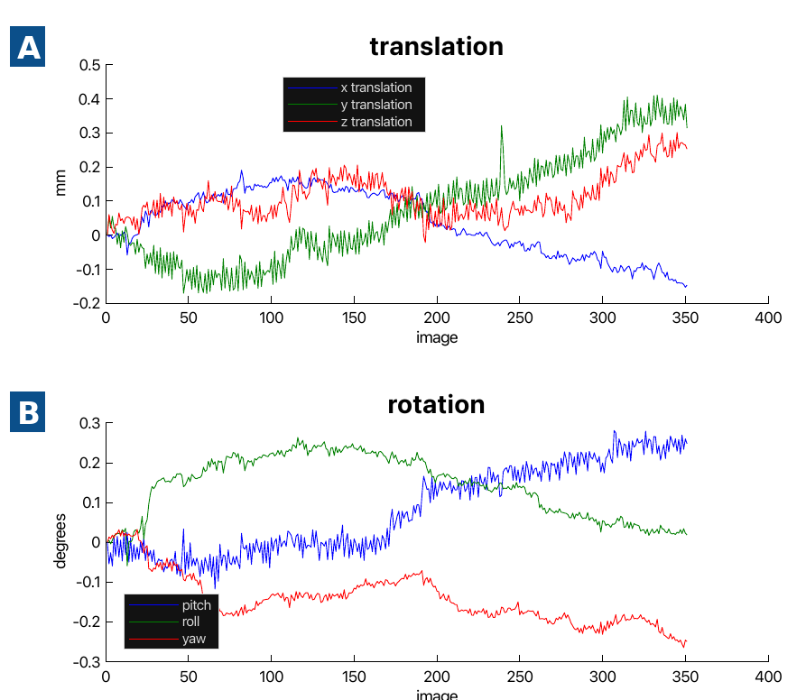
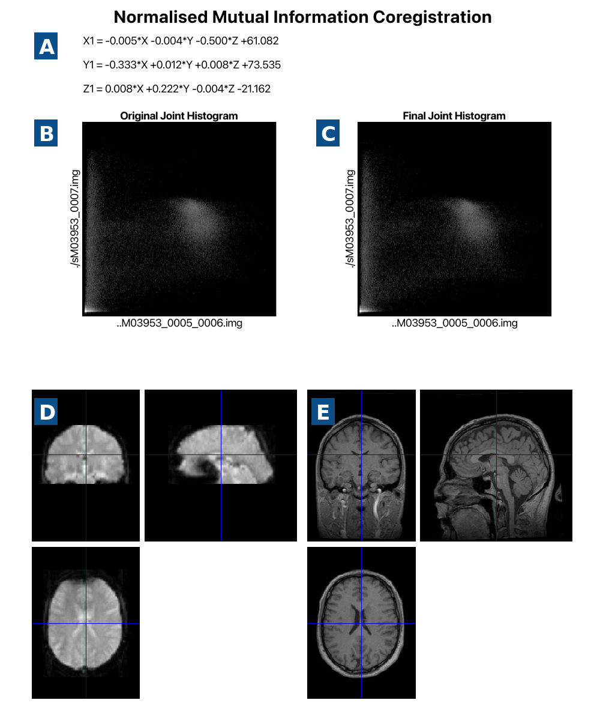
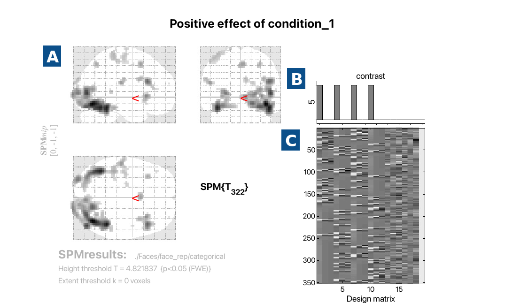
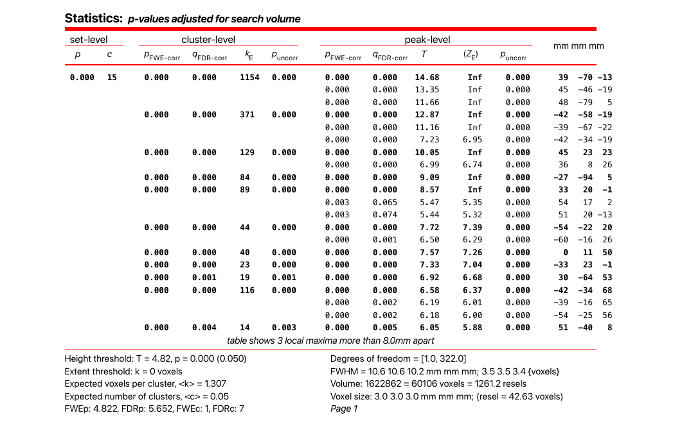
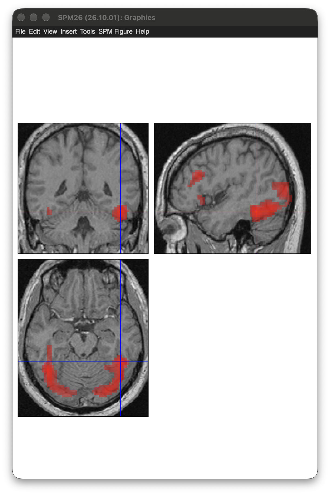
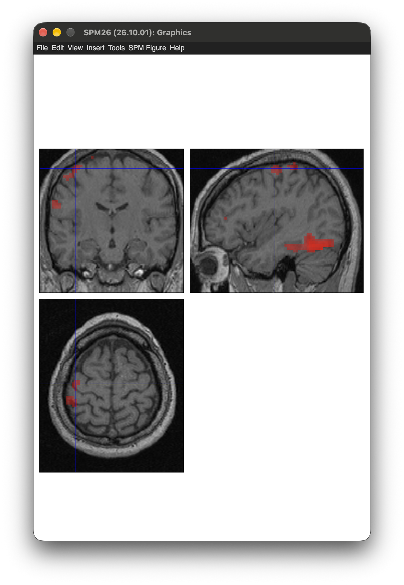
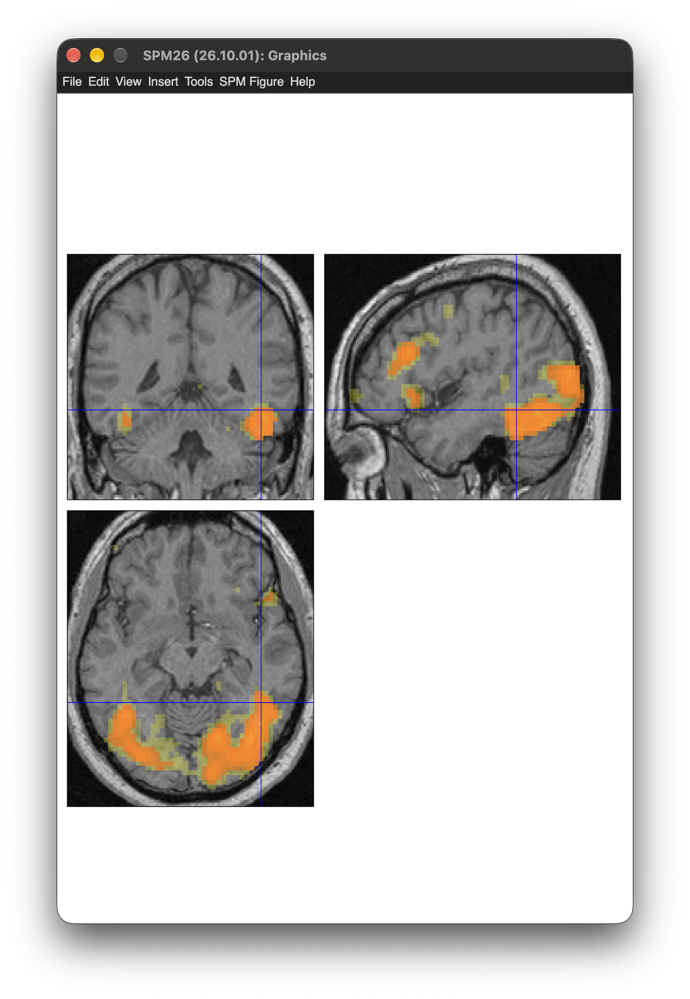
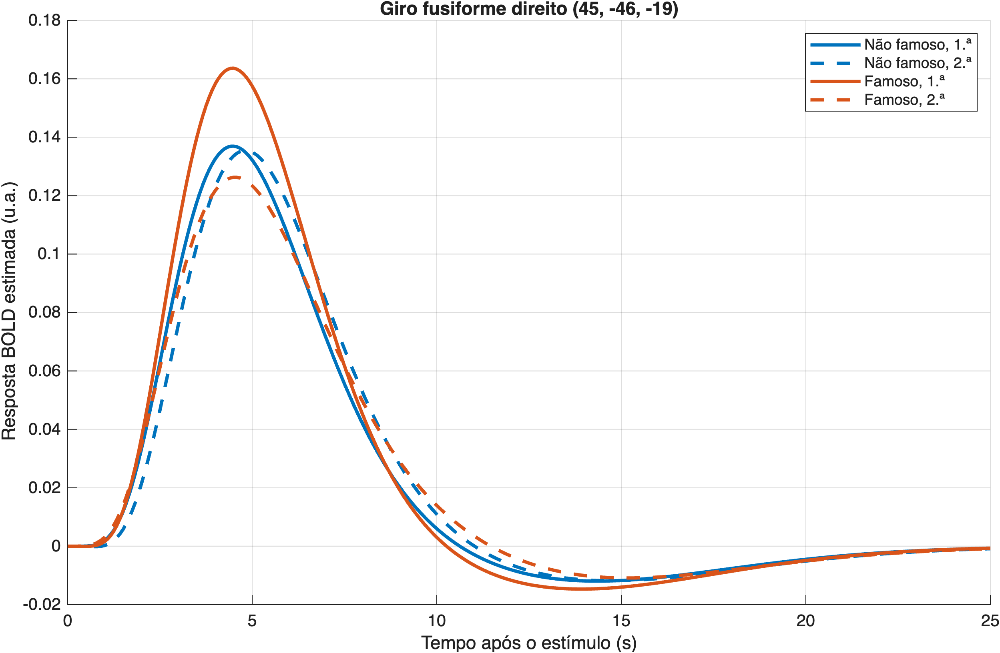

# Tutorial: análise de fMRI com o SPM (repetição de rostos)

Trabalho prático B da unidade curricular **Métodos de Imagem Médica** (NOVA FCT, 2026/27).
**Autores:** Francisca Morgado, Carolina Reis

Este repositório é um tutorial do [SPM](https://www.fil.ion.ucl.ac.uk/spm/) (*Statistical Parametric Mapping*),
o software de referência para analisar ressonância magnética funcional (fMRI). Mostra, passo a passo,
como se vai das imagens brutas de um exame até a um mapa das regiões do cérebro que respondem a rostos,
e inclui duas variações à análise: o efeito do limiar estatístico e a resposta hemodinâmica ao longo do tempo.

## Índice
1. [Requisitos e instalação](#1-requisitos-e-instalação)
2. [Os dados](#2-os-dados)
3. [Correr a análise](#3-correr-a-análise)
4. [O que o SPM faz em cada passo](#4-o-que-o-spm-faz-em-cada-passo)
5. [Ler os resultados](#5-ler-os-resultados)
6. [Figuras e variações](#6-figuras-e-variações)
7. [Conteúdo do repositório](#7-conteúdo-do-repositório)
8. [Referências](#8-referências)

---

## 1. Requisitos e instalação

- MATLAB (testado na versão R2026b), sem *toolboxes* adicionais
- SPM26 (versão 26.10.01), disponível no [GitHub do SPM](https://github.com/spm/spm/releases)
- Windows, macOS ou Linux; cerca de 1 GB de espaço livre

Descomprima o SPM numa pasta fixa e junte-a ao *path* do MATLAB (a lista de pastas onde o MATLAB procura funções):

```matlab
addpath /caminho/para/spm   % junta o SPM ao path
savepath                    % grava para as sessões seguintes
spm fmri                    % abre o SPM no modo fMRI
```

> **macOS (Apple Silicon):** o sistema bloqueia os ficheiros compilados do SPM (`.mexmaca64`) porque vieram da internet.
> Antes de abrir o SPM, retire a quarentena no Terminal: `xattr -r -d com.apple.quarantine /caminho/para/spm`

## 2. Os dados

Os dados **não estão incluídos** neste repositório: são o dataset de demonstração do SPM, disponibilizado para fins de ensino.
Descarregue-os da página oficial: https://www.fil.ion.ucl.ac.uk/spm/data/face_rep/

O estudo é o de Henson *et al.* (2002). Um sujeito viu fotografias de 26 rostos famosos e 26 não famosos,
cada uma duas vezes, por ordem aleatória, e indicou com a mão direita se o rosto era famoso.
Entre os rostos via um padrão em xadrez, que serve de **linha de base**. Há, por isso, quatro condições:

| | 1.ª vez | 2.ª vez |
|---|---|---|
| **Não famoso** | N1 | N2 |
| **Famoso** | F1 | F2 |

A pasta `face_rep` contém:
- `RawEPI/`: as 351 imagens funcionais (EPI), uma a cada 2 s
- `Structural/`: a imagem anatómica (T1)
- `sots.mat`: os momentos em que apareceu cada rosto

## 3. Correr a análise

Coloque numa mesma pasta a pasta `face_rep` e os dois *scripts* deste repositório. No MATLAB:

```matlab
cd /caminho/para/a/pasta
spm fmri
face_rep_spm12_batch     % análise completa (10 a 20 minutos)
comandos_figuras         % figuras e variações
```

O `face_rep_spm12_batch.m` é o *script* oficial do SPM para este dataset. A única alteração foi desativar as
linhas 16–18, que voltavam a descarregar os dados com uma função antiga (`urlwrite`) que já não funciona.

> Durante a análise aparecem avisos a laranja, como *"No voxels survive"*. Não são erros: indicam apenas que algum dos
> contrastes testados automaticamente não teve resultados significativos.

## 4. O que o SPM faz em cada passo

O *script* preenche uma variável `matlabbatch`, em que cada elemento é um passo do SPM com os seus parâmetros,
e no fim executa-os por ordem com `spm_jobman('run', matlabbatch)`. Os passos são:

| Passo | O que faz | Porquê |
|---|---|---|
| Realinhamento | Alinha todas as imagens com a primeira | O sujeito mexe-se durante o exame |
| Correção temporal dos cortes | Corrige o facto de os cortes de cada volume serem adquiridos em momentos diferentes | Os rostos são eventos curtos, e 1–2 s de diferença importam |
| Corregisto | Alinha as imagens funcionais com a anatómica | Para saber em que estrutura está cada ativação |
| Segmentação | Separa substância cinzenta, branca e líquido | Necessário para a normalização |
| Normalização | Deforma o cérebro do sujeito para um cérebro padrão (espaço MNI) | Permite usar coordenadas e atlas comuns |
| Suavização | Aplica um filtro gaussiano | Reduz o ruído e é exigida pela estatística do SPM |
| Modelo e estimação | Ajusta o modelo linear geral em cada voxel | Mede quanto cada condição explica o sinal |
| Contrastes | Testa hipóteses, como "rostos > linha de base" | Produz os mapas estatísticos |

Cada passo acrescenta uma letra ao nome dos ficheiros: `r` (realinhado), `a` (corrigido no tempo),
`w` (normalizado) e `s` (suavizado). Por isso, as imagens que entram no modelo chamam-se `swarsM03953_…`.

### Realinhamento



O gráfico **A** mostra o deslocamento da cabeça (em mm) e o **B** a rotação (em graus) ao longo das 351 imagens.
Cada cor é uma direção. O movimento máximo foi inferior a 0,5 mm e 0,3°, muito menos do que um voxel (3 mm),
o que indica dados de boa qualidade.

### Corregisto



As equações (**A**) são a transformação calculada entre as duas imagens. Os histogramas conjuntos (**B** antes, **C** depois)
contam quantos voxels têm cada par de intensidades nas duas imagens; o SPM procura a posição que torna estas manchas
mais concentradas (*informação mútua*). Em baixo, a imagem funcional (**D**, desfocada mas rápida) e a anatómica
(**E**, nítida), com a cruz azul no mesmo ponto nas duas.

### O modelo linear geral

Em cada voxel, o SPM ajusta

$$Y = X\beta + \varepsilon$$

- $Y$: o sinal medido nesse voxel ao longo do tempo
- $X$: a matriz de desenho, com a resposta esperada a cada condição (uma linha por imagem, uma coluna por regressor)
- $\beta$: quanto cada coluna contribui para o sinal (o que o SPM estima)
- $\varepsilon$: o ruído

Cada condição é modelada com três funções de base: a resposta hemodinâmica canónica e as suas derivadas
temporal e de dispersão, que permitem pequenos ajustes de atraso e de largura. Com 4 condições, isto dá 12 colunas,
mais as de movimento e a constante.

## 5. Ler os resultados

No menu do SPM: **Results** → `face_rep/categorical/SPM.mat` → contraste **005** (*Positive effect of condition_1*,
ou seja, rostos > linha de base) → *masking*: **none** → *p value adjustment*: **FWE** → *threshold*: **0.05** → *extent*: **0**.



- **A**: o cérebro "de vidro" (vistas de lado, de trás e de cima), com todos os voxels significativos
- **B**: o contraste, que soma as colunas da resposta canónica das quatro condições (1, 4, 7 e 10)
- **C**: a matriz de desenho; as faixas brancas marcam os momentos em que apareceu um rosto



Cada linha a negrito é um *cluster* (grupo de voxels ativos vizinhos). As colunas mais importantes:

| Coluna | Significado |
|---|---|
| $k_E$ | Tamanho do *cluster*, em voxels |
| $p_{FWE\text{-}corr}$ | Probabilidade corrigida para o cérebro inteiro (*family-wise error*) |
| $T$ | Valor da estatística no pico |
| mm mm mm | Coordenadas do pico no espaço MNI |

Com $p < 0{,}05$ corrigido por FWE (limiar $T > 4{,}82$) obtivemos **2100 voxels ativos em 15 *clusters***.
Para dar nome às regiões, perguntámos ao atlas Neuromorphometrics do SPM (secção 1 do `comandos_figuras.m`):

| Região | Função | Voxels |
|---|---|---|
| Giro fusiforme e occipital direito | Reconhecimento de rostos | 1154 |
| Giro fusiforme esquerdo | Reconhecimento de rostos | 371 |
| Giro frontal inferior direito | Decisão (famoso ou não) | 129 |
| Giro occipital inferior esquerdo | Processamento visual | 84 |
| Giro pré-central esquerdo | Movimento da mão direita | 116 |

## 6. Figuras e variações

O `comandos_figuras.m` está dividido em secções, que podem ser corridas uma a uma (*Run Section*).

### Ativação sobre a anatomia (secções 2 e 3)




Cortes coronal (de frente), sagital (de lado) e axial (de cima) da anatómica do sujeito, com os voxels
significativos a vermelho; o lado direito da imagem é o hemisfério direito. Em cima, a cruz está no giro fusiforme
direito; em baixo, no giro pré-central esquerdo, que controla a mão direita usada nas respostas.

### Variação 1: com e sem correção para comparações múltiplas (secção 4)



A laranja, os voxels significativos com FWE (2100). A amarelo, os que só passam sem correção, $p < 0{,}001$
(5029 no total). Com cerca de 60 000 testes, um por voxel, esperam-se $60\,106 \times 0{,}001 \approx 60$
falsos positivos só por acaso, o que mostra a importância da correção.

### Variação 2: resposta hemodinâmica no giro fusiforme direito (secção 5)



A resposta a cada condição é reconstruída a partir dos três $\beta$ estimados nesse voxel:
$h(t) = \beta_1 f_1(t) + \beta_2 f_2(t) + \beta_3 f_3(t)$, em que $f_1$, $f_2$ e $f_3$ são as funções de base.
Todas as curvas têm a forma típica do sinal BOLD, com o máximo perto dos 5 s. Na 2.ª apresentação de rostos famosos,
o pico desce cerca de 23 % (0,163 → 0,126); nos não famosos quase não muda. É a supressão por repetição.

### Teste F1 > F2 (secção 6)

Testámos se esta descida é significativa no mesmo voxel:

$$T = \frac{c^\top \hat\beta}{\sqrt{\hat\sigma^2\, c^\top (X^\top X)^{-1} c}}$$

em que $c$ é o vetor do contraste (+1 para F1, −1 para F2) e $\hat\sigma^2$ a variância do ruído.
Resultado: **T = 1,51, p = 0,066** (interação fama × repetição: T = 1,30, p = 0,098). Não é significativo,
o que é esperado com um único sujeito; o estudo original encontrou o efeito com 12.

## 7. Conteúdo do repositório

| Ficheiro | Descrição |
|---|---|
| `face_rep_spm12_batch.m` | *Script* oficial do SPM: pré-processamento, modelo e contrastes (linhas 16–18 desativadas) |
| `comandos_figuras.m` | Atlas, figuras sobre a anatomia, comparação de limiares, resposta hemodinâmica e teste F1 > F2 |
| `Resultados/` | Figuras finais |
| `Resultados/tutorial/` | Figuras do SPM usadas neste tutorial |
| `Resultados/Relatorios spm/` | Relatórios em PDF gerados pelo SPM (realinhamento e corregisto) |
| `Resultados/Rascunhos/` | Versões preliminares das figuras |

## 8. Referências

- Tierney, T. M. *et al.* (2025). SPM 25: open source neuroimaging analysis software. *Journal of Open Source Software*, 10(110), 8103.
- Friston, K. J. *et al.* (1994). Statistical parametric maps in functional imaging: a general linear approach. *Human Brain Mapping*, 2(4), 189–210.
- Henson, R. N. A. *et al.* (2002). Face repetition effects in implicit and explicit memory tests as measured by fMRI. *Cerebral Cortex*, 12(2), 178–186.
- Functional Imaging Laboratory, UCL. Face fMRI data: repetition priming for famous and non-famous faces. https://www.fil.ion.ucl.ac.uk/spm/data/face_rep/
